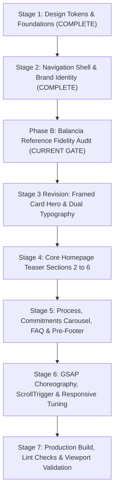

# SAVELIX — Balancia Reference Fidelity Audit and Implementation Blueprint

**Document Version:** 1.0.0  
**Date:** October 15, 2026  
**Project Workspace:** `c:/Users/shale/Downloads/Savelix-Fkode` (configured alias: `d:/Savelix-Fkode`)  
**Status:** Audit & Blueprint Complete — Awaiting Approval Before Next Coding Phase  

---

## Executive Summary & Objective

The objective of this blueprint is to establish a rigorous, reference-led specification for reproducing the visual design language, interaction patterns, typographic rhythm, and responsive choreography of the **VamTam Balancia Psychologist** reference theme ([Live Reference](https://balancia.vamtam.com/psychologist/) | [Theme Preview](https://themes.vamtam.com/?theme=balancia&n=2&storefront=envato-market)) within the **SAVELIX Psychiatric Clinic & Rehabilitation Centre** web platform.

This is a **reference-led implementation**, not a generic healthcare template. Generic substitutions, arbitrary animations, and unverified content inventions are strictly prohibited. The implementation faithfully captures the elegance, spaciousness, and organic harmony of Balancia while strictly preserving:
1. **The approved SAVELIX Content & Structure Plan** (Sections 01–09, Pages A–I; zero fabricated doctors, fake testimonials, or unapproved medical claims).
2. **The official SAVELIX brand emblem logo** (`/assets/savelix-logo.jpg`) with verified proportions and clear space.
3. **The established SAVELIX Colour Tokens** (`#F7F3FA` Pale Lilac, `#EDE5F4` Soft Lavender, `#8065A8` Muted Purple, `#302B50` Deep Plum, `#666477` Soft Grey, `#E4DCEB` Hairline Border).
4. **The modular React 19 architecture** and completed Stage 1 Foundation and Stage 2 Navigation Shell.

---

## Phase A & B: Reference Design Audit Specification

### 1. Global Design System

| Dimension / Element | Measured Value (Reference) | Observation Type | SAVELIX Adaptation Standard |
| :--- | :--- | :--- | :--- |
| **Site Max Width** | `1280px` (`--vamtam-site-max-width`) | **Measured value** | `max-w-7xl` (`1280px`) centered container |
| **Outer Canvas Margins** | Desktop: `20px` - `30px`; Mobile: `16px` | **Measured value** | `px-4 sm:px-6 lg:px-8` |
| **Canvas Background** | `#FAF2EA` (Warm Linen Cream) | **Measured value** | `#F7F3FA` (SAVELIX Pale Lilac) |
| **Section Vertical Spacing** | `14vh` (~110px–140px); Inner pads `7vh` | **Measured value** | `py-20 lg:py-28` (`80px`–`112px`) |
| **Hero Frame Radius** | `42px` all corners (`border-radius: 42px`) | **Measured value** | `rounded-[36px]` or `rounded-[42px]` |
| **Feature Card Radius** | `24px` all corners (`border-radius: 24px`) | **Measured value** | `rounded-3xl` (`24px`) |
| **Utility / Inner Card Radius**| `12px` - `16px` | **Measured value** | `rounded-xl` (`12px`) |
| **Button Radius** | `80px` / `9999px` (Full Pill) | **Measured value** | `rounded-full` (`999px`) |
| **Circular Media Radius** | `50%` (Circle) | **Measured value** | `rounded-full` (`50%`) |
| **Primary Button Height/Padding**| `14px 28px` to `16px 32px` | **Measured value** | `px-6 sm:px-7 py-3 sm:py-3.5` |
| **Surface Hairline Borders**| `1px solid rgba(0, 0, 0, 0.08)` / `#E4DCEB` | **Measured value** | `border border-savelix-border` (`#E4DCEB`) |
| **Surface Elevations** | `0 20px 30px rgba(0,0,0,0.12)` (cards) | **Measured value** | `shadow-savelix-lg` / `hover:shadow-2xl` |
| **Ambient Glow Treatment** | `radial-gradient` + `box-shadow: 0 0 200px 100px #E9FFF4` | **Measured value** | Lavender ambient blur (`#EDE5F4`, `blur-3xl`) |

#### Typography Hierarchy & Font Pairings
Balancia achieves its editorial sophistication by pairing an expressive classical serif with a contemporary geometric sans-serif:
- **Headings & Editorial Accents:** `Baskervville`, serif (Normal weight 400, distinctive italic slant on emotional/key action words: *based*, *therapy*, *psychological*, *focus*, *start*, *my*, *care*, *want*).
- **Body, Navigation, Kicker Labels & Buttons:** `Manrope` / `Plus Jakarta Sans`, sans-serif (Weights: 400 Regular, 500 Medium, 600 SemiBold, 700 Bold).
- **H1 Display (Hero):** Desktop `56px`–`64px`, Line-height `1.15`, Letter-spacing `-0.02em`. Mobile: `32px`–`36px`.
- **H2 Section Titles:** Desktop `40px`–`48px`, Line-height `1.2`, Serif italic keyword accents. Mobile: `28px`–`32px`.
- **H3 Section Kickers:** `13px`–`14px`, Uppercase, Letter-spacing `0.12em`–`0.15em`, Sans-serif, Bold (`#8065A8` Muted Purple or `#666477` Soft Grey).
- **H4 Card Titles:** `20px`–`24px`, Sans-serif or Serif, Line-height `1.3`.
- **Body Copy:** `15px`–`16px`, Line-height `1.65`, `#666477` Soft Grey.

---

### 2. Navigation and Dropdowns

#### Header Dimensions & Structure
- **Height & Inset:** Header height is `80px` (`min-height: 80px`). In desktop view, the Hero section has a negative top margin (`--margin-top: -82px`), allowing the transparent/frosted header to sit directly over the hero media container.
- **Scroll Behavior:** Transitions to a frosted glass background (`backdrop-filter: blur(16px); background: rgba(247, 243, 250, 0.92); border-bottom: 1px solid rgba(228, 220, 235, 0.6);`).
- **Logo Area:** Left-aligned. SAVELIX official emblem logo sized at `h-11 sm:h-12 md:h-14` with crisp aspect ratio and no distortion.
- **Navigation Links:** Horizontal layout (`gap: 32px`), font-size `15px`, font-weight `500`, `#302B50` Deep Plum. Active state is denoted by `#8065A8` text and an animated underline indicator.
- **Header Action CTA:** Far right pill button ("Book an Appointment") with circular arrow icon wrapper.

#### Desktop Dropdown Architecture
- **Trigger:** Seamless hover with a `150ms` grace timeout to prevent accidental dismissal, alongside full keyboard Tab focus and `Enter`/`Space`/`Escape` accessibility.
- **Container Styling:**
  * Background: Pure White (`#FFFFFF`).
  * Radius: `16px` (`rounded-2xl`).
  * Shadow: `0 12px 36px -6px rgba(48, 43, 80, 0.12), 0 4px 12px -2px rgba(48, 43, 80, 0.06)`.
  * Border: `1px solid #E4DCEB`.
  * Padding: `20px 24px`.
- **Menu Items:** Rich 2-column or structured 1-column service items, with title (`#302B50`, font-weight 600), micro-description (`#666477`, 12px), and subtle lavender hover pill (`#EDE5F4`).

#### Mobile Navigation Drawer
- **Trigger:** Hamburger icon on the right (`h-10 w-10`, touch target `44px+`).
- **Drawer Animation:** Full-height slide-in from right (`transform: translateX(0)`), overlaying a darkened backdrop (`bg-black/30`).
- **Submenu Accordions:** Expandable/collapsible accordion panels for Services (`max-height` transition with rotating chevron).
- **Drawer CTA:** Full-width pill button pinned at drawer bottom for immediate appointment booking.

---

### 3. Hero Section Audit

```
┌────────────────────────────────────────────────────────────────────────┐
│  [Header Shell: Logo ──────── Nav Links ─────── "Book an Appointment"] │
├────────────────────────────────────────────────────────────────────────┤
│  [Hero Outer Container - Margins 20px - Border Radius 42px]            │
│  ┌──────────────────────────────────────────────────────────────────┐  │
│  │  Background: Panoramic Clinical Atmosphere / Soft Abstract Bokeh │  │
│  │                                                                  │  │
│  │   "Evidence-based"             (Left Staggered, Serif Italic)    │  │
│  │                                                                  │  │
│  │                         "therapy for" (Right Shifted, Italic)    │  │
│  │                                                                  │  │
│  │                     [ rotating keyword ]                         │  │
│  │                                                                  │  │
│  │           In-person care in Chennai (Ambattur & Pudur)           │  │
│  │                 Comprehensive Outpatient & Inpatient             │  │
│  │                                                                  │  │
│  └─────────────────────────────────┬────────────────────────────────┘  │
│                                    │ [CTA: Book an Appointment ->]     │
│                                    └─(Half-Overlapping Bottom Edge)────│
└────────────────────────────────────────────────────────────────────────┘
```

#### Observable & Measured Details
1. **Container Framing:** Hero is **not** a standard edge-to-edge bleed block; it is an **inset card** framed within the page canvas with `margin: 0 20px` (desktop) and `border-radius: 42px`.
2. **Layering & Depth:**
   - Deep cinematic atmosphere background (rich lavender/navy tint).
   - Top-down subtle vignette ensuring high-contrast navbar legibility.
   - Dual-row staggered typography: Left row "Evidence-*based*", Right row "*therapy* for".
   - Central animated rotating headline displaying core SAVELIX specialties:
     `recovery` • `well-being` • `daily functioning` • `resilience`.
3. **Bottom Overlap CTA:** The primary action button sits precisely on the bottom border of the hero card (`margin-bottom: -35px` offset), creating a visual lock between the Hero and Section 2.
4. **Desktop vs Mobile Composition:**
   - Desktop: Dual staggered lines, 80vh clamp height, -35px overlapping button.
   - Mobile: Single-column centered stack, height relaxes to `auto` (`py-16`), button rests naturally with standard margins, font size scales down to `32px`.

---

### 4. Section-by-Section Architecture (Sections 2 – 14)

#### Section 2: Clinic & Founder Introduction (Balancia "Dr. Sara Parker" Pattern)
- **Reference Layout:** 2-column asymmetric split. Left column: star emblem icon, H2 serif heading, tracked uppercase badge, lead narrative, pill button. Right column: 3:4 portrait photo (`border-radius: 24px`, ambient radial glow).
- **SAVELIX Approved Content Mapping:**
  * Kicker: `15+ YEARS OF DEDICATED CARE & CLINICAL EXCELLENCE`
  * H2 Heading: `Compassionate Care Grounded in Proven Science`
  * Lead Copy: Condensation of Page 5 (About Us, Our Approach): "Mental health difficulties affect thoughts, emotions, behaviour, relationships, education, and daily activities. Care at SAVELIX considers the whole person rather than focusing only on symptoms."
  * CTA Button: `Learn About Savelix` (linking to `/about`).
  * Right Image: Clinical facility / therapeutic care setting with `rounded-3xl` and soft lavender ambient glow.

#### Section 3: Feature Pillars (Balancia "Effective psychological treatment" Pattern)
- **Reference Layout:** Centered H2 serif ("Effective *psychological* treatment") + H3 kicker ("WHY TO CHOOSE ME"). 3 equal-width columns separated by fine vertical borders, each featuring a top line-art illustration (`190px`), H4 title with italic keyword, and 3-line description.
- **SAVELIX Approved Content Mapping:**
  * Kicker: `WHY CHOOSE SAVELIX`
  * H2 Heading: `Comprehensive Care for Meaningful Recovery`
  * Column 1:
    - Title: `Integrated Psychiatric Care`
    - Copy: "Psychiatric evaluation, evidence-based medication management, and ongoing clinical symptom monitoring."
  * Column 2:
    - Title: `Evidence-Informed Therapy`
    - Copy: "Individual counselling, CBT, DBT-informed emotion regulation, and structured stress management."
  * Column 3:
    - Title: `Rehabilitation & Life Skills`
    - Copy: "Structured daily routines, social skills training, functional independence, and family-centred recovery."

#### Section 4: Clinical Modalities / Areas of Focus (Balancia Dark Plum 4-Card Grid)
- **Reference Layout:** Deep Plum container (`#352A44`, `border-radius: 24px`, `padding: 7vh 30px`). Centered H2 serif in white + H3 kicker. 4-column loop grid (desktop: 4, tablet: 2, mobile: 1).
- **Card Anatomy:**
  * `border-radius: 24px`, overflow hidden.
  * Photographic upper half with smooth zoom on hover (`scale(1.04)`).
  * Bottom half shaded with a gradient overlay (`linear-gradient(180deg, rgba(48,43,80,0) 0%, #302B50 100%)`).
  * Emblem star icon, H3 title, and 3 distinct bullet points with custom dots.
  * Card hover elevation: `translateY(-6px)` with soft deep shadow.
- **SAVELIX Approved Content Mapping:**
  * Kicker: `STRUCTURED CARE TAILORED TO YOUR NEEDS`
  * H2 Heading: `Core Areas of Clinical Focus`
  * Card 1: **Adult Psychiatric Care**
    - Bullets: • Comprehensive Assessment • Medication Management • Relapse Prevention
    - Link: `/services/psychiatric-care`
  * Card 2: **Psychological Counselling**
    - Bullets: • Psychotherapy & CBT • Emotional Regulation • Coping Strategies
    - Link: `/services/psychological-counselling`
  * Card 3: **Psychiatric Rehabilitation**
    - Bullets: • Daily Living Routines • Social Skills Training • Functional Independence
    - Link: `/services/psychiatric-rehabilitation`
  * Card 4: **Child, Adolescent & Family Support**
    - Bullets: • Developmental Concerns • Relationship Guidance • Family Psychoeducation
    - Link: `/services/child-adolescent-counselling`

#### Section 5: Conditions Wheel (Balancia "I help with:" Radial Pattern)
- **Reference Layout:** Gigantic circular ring layout (`border-radius: 50%`, `border: 1px solid #E4DCEB`, `min-height: 1040px`). Central circular photo (`420px x 420px`, `rounded-full`). Symmetrical flanking clinical tags (4 on left, 4 on right) with star emblem icons, connected to central photo. Bottom pill button: "Learn more".
- **SAVELIX Approved Content Mapping:**
  * Kicker: `CLINICAL CONDITIONS WE SUPPORT`
  * H2 Heading: `Support for a Range of Mental Health Concerns`
  * Central Visual: 420px circular photo representing supportive, compassionate care.
  * Left Flank Nodes (4 items from Page 7):
    1. Anxiety & Stress Disorders
    2. Depression & Mood Concerns
    3. Obsessive-Compulsive Disorder (OCD)
    4. Personality Difficulties & BPD
  * Right Flank Nodes (4 items from Page 7):
    5. Psychotic Disorders & Schizophrenia
    6. Neurocognitive Conditions & Memory
    7. Substance Use & Addiction Recovery
    8. Sleep & Adjustment Difficulties
  * Bottom Button: `Explore All Conditions` (linking to `/conditions`).
  * **Responsive Finding & Fallback:** On screens `< 1024px`, the 1040px circular wheel will cause clipping. The responsive rule converts this into a centered circular portrait framed by an elegant 2-column grid of pill badges on tablet, and a clean vertical tag cluster on mobile.

#### Section 6: Inpatient Environment & Safety (Balancia "Testing & Evaluations" Pattern)
- **Reference Layout:** 2-column split. Left: H2 serif heading, descriptive overview, pill CTA. Right: 4 distinct card links with bullet icons and subtle hover background shifts.
- **SAVELIX Approved Content Mapping (Page 8):**
  * Left Column:
    - H2 Heading: `Safe, Structured Inpatient Environment & Monitoring`
    - Copy: "Routine hygiene, infection control, regular safety checks, and continuous monitoring implemented respectfully while maintaining dignity, privacy, and therapeutic engagement."
    - Button: `Inpatient Safety Details` (linking to `/services/inpatient-safety-monitoring`).
  * Right Column (4 Structured Service Cards):
    1. Routine Cleanliness, Ventilation & Safety Checks
    2. Safe Medicine Storage, Handling & Administration
    3. Infection Prevention & Environmental Hazard Control
    4. Dignity-Preserving Patient & Family Coordination

#### Section 7: Multidisciplinary Collaborations / Verification Band (Balancia Insurance Logos)
- **Reference Layout:** Centered H4 kicker ("Covered by major insurance providers") + horizontal flex row of 6 muted grayscale logos.
- **SAVELIX Adaptation Rule:**
  * SAVELIX cannot copy Balancia's US insurance provider logos (Anthem, Aetna, Cigna, etc.) as they are unverified for this clinic.
  * Instead, adapt this section to a **Multidisciplinary Clinical Care Standards Band**:
    - Kicker: `COLLABORATIVE CLINICAL CARE STANDARDS`
    - Badges/Emblems: Integrated Psychiatry • Clinical Psychology • Psychiatric Rehabilitation • Family Psychoeducation • Ethical & Confidential Care • Supervised Clinical Training.

#### Section 8: Step-by-Step Care Journey (Balancia "How to start therapy" Pattern)
- **Reference Layout:** Centered H2 serif + H3 kicker. 4 sequential columns with large numbered indicators (`1`, `2`, `3`, `4`), star emblems, titles, descriptions, and a centered bottom CTA button.
- **SAVELIX Approved Content Mapping (Page 5 Care Journey):**
  * Kicker: `YOUR PATHWAY TO RECOVERY`
  * H2 Heading: `How Care Progresses at Savelix`
  * Step 1: `Initial Evaluation` — "Comprehensive psychiatric assessment and mental status evaluation to understand your unique needs."
  * Step 2: `Personalised Care Plan` — "Collaborative formulation of medical, psychological, and lifestyle recovery strategies."
  * Step 3: `Active Treatment & Therapy` — "Evidence-based psychiatric care, psychological counselling, and family psychoeducation."
  * Step 4: `Rehabilitation & Recovery` — "Structured routines, life skills, functional independence, and ongoing relapse-prevention."
  * Bottom Button: `Book a Consultation` (triggers Appointment Modal).

#### Section 9: Calming Reassurance Banner (Balancia "Feel like yourself again" Pattern)
- **Reference Layout:** Panoramic image banner with deep gradient overlay. Centered H2 serif ("Feel like yourself again.") + H3 sans ("Let's get there together.") + 2 contrasting CTA buttons.
- **SAVELIX Approved Content Mapping (Page 14 Final CTA):**
  * H2 Heading: `Take the First Step Towards Better Mental Health`
  * H3 Subtitle: `Your mental health matters. You don't have to face your challenges alone.`
  * CTA 1: Primary pill button `Book an Appointment` (modal trigger).
  * CTA 2: Secondary pill button `Contact Clinic` (links to `/contact`).

#### Section 10: Care Commitments & Recovery Focus (Balancia Testimonials Carousel)
- **Reference Layout:** Centered H2 serif ("Hear from my clients"). Swiper carousel with 4 cards (desktop), 3 (tablet), 1 (mobile). Large quote marks, names, roles, quotes, circular prev/next arrows.
- **SAVELIX Adaptation Rule:**
  * **Strict Content Rule:** Balancia's fictional patient reviews ("Josh - manager", "Milla - artist") must **never** be copied, and no fake client testimonials can be invented.
  * Adapt this component into a **"Core Values & Commitment to Care" Carousel** using verbatim principles from Page 5 & Page 13:
    1. *Dignity & Respect:* "Treating each individual with unconditional positive regard, privacy, and clinical compassion."
    2. *Evidence-Informed Care:* "Utilising clinically validated therapies, structured interventions, and transparent treatment plans."
    3. *Family-Centred Partnership:* "Equipping families with guidance, communication skills, and relapse warning education."
    4. *Recovery & Inclusion:* "Focusing on daily functioning, social re-integration, and sustained quality of life."
  * Interactive circular prev/next buttons remain identical to Balancia.

#### Section 11: Clinical Questions / Scope Overview (Balancia FAQ Accordion)
- **Reference Layout:** 2-column split. Left column: H2 serif ("Frequently Asked Questions") + H3 kicker + pill button ("Read our FAQ's"). Right column: 5-item `<details>` accordion with animated max-height expansion.
- **SAVELIX Adaptation Rule:**
  * The Content Plan (Page 2 & 15) states: *"Do not build Patient Resources or FAQs until the client provides approved content for them."*
  * **Resolution:** To maintain 100% visual fidelity to Balancia's 2-column accordion pattern without inventing clinical FAQs, this component will serve as **"Understanding Our Care Services: Key Information"**, populated strictly from approved copy:
    1. *What should I expect during an initial consultation?* (Assessment & diagnostic review copy from Page 6).
    2. *How is family involved in treatment?* (Family involvement policy from Page 5).
    3. *What is psychiatric rehabilitation?* (Structured daily routines & skills copy from Page 6).
    4. *Who can apply for internship opportunities?* (Student eligibility copy from Page 12).
    5. *How are patient safety and privacy protected?* (Safety principles copy from Page 8).

#### Section 12: Education & Clinical Insights (Balancia "The psychology journal" Pattern)
- **Reference Layout:** Centered H2 serif ("The *psychology* journal") + H3 kicker. 3-column grid of image cards with overlapping bottom gradient cards, date badges, and article titles.
- **SAVELIX Approved Content Mapping (Page 12 Education & Internship):**
  * Kicker: `ACADEMIC & CLINICAL EXPOSURE`
  * H2 Heading: `Education, Training and Clinical Learning`
  * Card 1: `Theoretical Learning in Psychiatry` — Fundamentals of MSE, psychopathology, and abnormal psychology.
  * Card 2: `Supervised Clinical Observation` — Diagnostic procedures, psychoeducation, and multidisciplinary case rounds.
  * Card 3: `Rehabilitation & Therapeutic Activities` — Activity-based interventions, patient engagement, and functional skills.
  * Bottom Button: `Internship Programme Details` (linking to `/education-internship`).

#### Section 13: Pre-Footer Consultation & Contact Card (Balancia Contact Card Pattern)
- **Reference Layout:** Soft pastel gradient card container. Left: H2 serif ("Professional *psychological* support"), description, primary CTA pill button, phone CTA pill. Right: Doctor license, address, email, 2 vertical nav menus.
- **SAVELIX Approved Content Mapping (Page 4, 14, 15):**
  * Left:
    - H2 Heading: `Professional Mental Healthcare & Support`
    - Subtitle: "Savelix Psychiatric Clinic and Rehabilitation Centre — Empowering Mental Health and Emotional Well-being."
    - Buttons: `Book an Appointment` (modal) and `Contact Us` (navigates to `/contact`).
  * Right:
    - Verified Location Phrases (Page 14): "Psychiatric Clinic & Rehabilitation Centre — Ambattur & Pudur, Chennai".
    - 2 Navigation Menus: Approved Main Links (About Us, Services, Conditions, Why Savelix) & Dedicated Service Links.

#### Section 14: Dark Footer Bar
- **Reference Layout:** Dark Charcoal (`#1E1F20`) bar with copyright, social icons (circle wrappers), and legal links.
- **SAVELIX Standard:** `#302B50` Deep Plum background, copyright (`2026 SAVELIX Psychiatric Clinic & Rehabilitation Centre. All rights reserved.`), ethical care notes, and accessible back-to-top button.

---

## Phase C: SAVELIX Adaptation Matrix

| Balancia Reference Element | Balancia Original Content | SAVELIX Approved Adaptation | Content Source Authority |
| :--- | :--- | :--- | :--- |
| **Brand Logo** | "Balancia" typography SVG | Official SAVELIX Logo Emblem with floral cross & hands | Approved Logo Asset (`/assets/savelix-logo.jpg`) |
| **Color Tokens** | Beige `#FAF2EA`, Plum `#352A44`, Mint `#E9FFF4` | `#F7F3FA`, `#EDE5F4`, `#8065A8`, `#302B50` | Colour Palette PDF (Pages 2–6) |
| **Hero Media** | Video loop of model with luminous orb | Calming psychiatric clinic / abstract serenity visual | Content Plan (Page 15: "calm imagery") |
| **Hero Title** | "Evidence-based therapy for [relationships / anxiety / trauma]" | "Comprehensive Mental Healthcare for Better Living — [Assessment / Care / Recovery / Living]" | Content Plan (Page 3: Section 01 Hero) |
| **Doctor Bio** | "Dr. Sara Parker, PhD — 15+ years of dedicated practice" | SAVELIX Clinic Overview — Compassionate, Evidence-Informed Care | Content Plan (Page 5: Page A About Us) |
| **Areas of Focus** | Individual, Couples, Pediatric, Telehealth | Psychiatric Care, Psychological Counselling, Rehabilitation, Child/Family | Content Plan (Page 3 & 6: Services) |
| **"I Help With:" Wheel**| 8 radial tags around therapist portrait | 8 approved condition categories around central visual | Content Plan (Page 7: Conditions We Support) |
| **Process Steps** | Free Consultation, Individualized Care, Schedule, Start | Assessment, Personalised Plan, Multidisciplinary Care, Rehabilitation | Content Plan (Page 5 & 8: Care Journey) |
| **Testimonials** | Fictional client quotes (Josh, Milla, Sophia, Ethan) | 4 Core Values & Principles (Compassion, Dignity, Evidence, Recovery) | Content Plan (Page 5: Core Values) |
| **FAQ Items** | Costs, insurance, session lengths | 5 Clinical Scope clarifications (Assessment, Family, Rehab, Interns, Safety) | Content Plan (Page 5, 6, 8, 12) |
| **Blog Journal** | "How to know when it's a problem", etc. | Education & Internship Focus (Theoretical, Clinical, Practical) | Content Plan (Page 12: Page H) |
| **Pre-Footer Contact** | Fictional NY license & 5th Ave address | Ambattur / Pudur, Chennai clinic location phrasing | Content Plan (Page 14: Search Phrases) |

---

## Phase D: Animation & Motion Specification

### Recommended Animation Stack
- **Engine:** GSAP 3.15 + `@gsap/react` (`useGSAP`).
- **Plugins:** `ScrollTrigger`.
- **Responsive Handling:** `gsap.matchMedia()`.
- **CSS Transitions:** Standard CSS for button hovers, dropdown opacities, and icon translations (`transform`, `opacity` only).

### Detailed Motion Inventory

| Animation Target | Visible Effect in Reference | Trigger & Scroll Relationship | GSAP / CSS Implementation Strategy |
| :--- | :--- | :--- | :--- |
| **Hero Entrance** | Staggered fade-up of headline words | Page load (immediate) | `gsap.from([line1, line2], { y: 28, opacity: 0, duration: 0.8, stagger: 0.14, ease: 'power2.out' })` |
| **Headline Rotating Word**| Vertical blinds/fade flip of rotating keywords | Infinite loop (interval `2500ms`) | React state transition with CSS keyframe `translateY` or GSAP timeline |
| **Hero Bottom CTA** | Overlaps hero frame bottom edge | Positioned with negative margin | Native layout placement (`margin-bottom: -35px; z-index: 10`) |
| **Section Headings** | Subtle slide-up + fade-in | ScrollTrigger `top 85%` | `gsap.from(heading, { scrollTrigger: { trigger: heading, start: 'top 85%' }, y: 24, opacity: 0, duration: 0.6 })` |
| **Feature Cards (Areas of Focus)**| Staggered reveal across the 4 columns | ScrollTrigger `top 80%` | `gsap.from(cards, { scrollTrigger: { trigger: grid, start: 'top 80%' }, y: 36, opacity: 0, stagger: 0.12, duration: 0.7 })` |
| **Card Hover Effect** | `translateY(-6px)` + deep shadow + image zoom | Cursor hover | CSS transition: `transform 0.3s ease, box-shadow 0.3s ease; img: hover:scale-105` |
| **Conditions Wheel** | Radial fade-in of 8 surrounding nodes | ScrollTrigger `top 75%` | Staggered opacity reveal from center outward (`stagger: 0.08`) |
| **Process Steps (1-4)** | Sequential line draw / step entrance | ScrollTrigger `top 80%` | `gsap.from(steps, { y: 30, opacity: 0, stagger: 0.15, duration: 0.6 })` |
| **Testimonial Carousel** | Horizontal glide with touch swipe | Manual arrow click / touch drag | React Swiper or CSS touch carousel with snap |
| **FAQ Accordion** | Smooth vertical height expansion | Click toggle | CSS grid transition (`grid-template-rows: 0fr -> 1fr`) or max-height |
| **Mobile Drawer** | Slide-in from right edge | Hamburger button toggle | CSS `translateX(100% -> 0)` with `cubic-bezier(0.16, 1, 0.3, 1)` |
| **Prefers-Reduced-Motion**| Instant display, zero transforms | System media query | `@media (prefers-reduced-motion: reduce) { * { animation: none !important; transition: none !important; } }` |

> [!IMPORTANT]
> **Implementation Rules for Motion:**
> 1. Never apply global `ScrollTrigger.killAll()` — use scoped `useGSAP({ scope: containerRef })` so triggers clean up automatically on route transitions.
> 2. Avoid continuous layout-thrashing animations on `width`, `height`, `top`, or `left`. Always animate `transform` (`x`, `y`, `scale`) and `opacity`.
> 3. Do not add heavy third-party smooth scroll libraries (e.g. Locomotive Scroll) as they conflict with native touch scrolling and introduce accessibility barriers. Native CSS `scroll-behavior: smooth` is already active in `index.css`.

---

## Phase E & F: Implementation Blueprint & Validation Gates



### Stage-by-Stage Implementation Roadmap

#### Gate 1: Blueprint Approval (Current Milestone)
- Present this document for client/user review.
- Confirm alignment on Balancia layout fidelity, typography pairing (Baskervville serif italic accents + Plus Jakarta Sans), and approved content mapping.

#### Gate 2: Hero Section Refinement (Stage 3 Rev)
- Upgrade `src/components/home/Hero.jsx`:
  * Transform container into an inset framed card with `border-radius: 42px`.
  * Implement the dual-line staggered H1 layout ("Comprehensive *Mental Healthcare*" / "*for Better* Living").
  * Add the central rotating keyword animation.
  * Implement the bottom overlapping pill button CTA (`margin-bottom: -35px`).
- Run `npm run lint` and `npm run build`.

#### Gate 3: Homepage Teaser Sections 2–6 (Stage 4)
- Create modular components in `src/components/home/`:
  * `AboutTeaser.jsx` (2-column asymmetric bio pattern).
  * `PillarsSection.jsx` (3 feature columns with line art).
  * `FocusGrid.jsx` (Deep Plum 4-card grid with image zoom and bullets).
  * `ConditionsWheel.jsx` (8-node circular diagram with mobile fallback).
  * `InpatientTeaser.jsx` (Safety monitoring checklist & card grid).
- Run `npm run lint` and `npm run build`.

#### Gate 4: Secondary Sections & Carousel (Stage 5)
- Create:
  * `PathwaySteps.jsx` (4-step numbered care journey).
  * `ReassuranceBanner.jsx` (Panoramic misty photo CTA banner).
  * `CommitmentsCarousel.jsx` (Touch/arrow testimonial-style carousel).
  * `ScopeAccordion.jsx` (2-column accessible FAQ-style accordion).
  * `EducationTeaser.jsx` (3-column academic journal cards).
  * `PreFooterCard.jsx` (Mint/lavender gradient consultation block).
- Run `npm run lint` and `npm run build`.

#### Gate 5: GSAP ScrollTrigger Integration (Stage 6)
- Wrap section entrances in `useGSAP` contexts.
- Configure `gsap.matchMedia()` for desktop (`min-width: 1024px`) vs mobile.
- Test scroll reversal, fast scrubbing, and page reload scroll anchors.

#### Gate 6: Production Validation & Verification (Stage 7)
- Run `npm run lint` (0 oxlint errors).
- Run `npm run build` (clean Vite production bundle).
- Perform side-by-side visual comparison against the Balancia reference at 1440px, 1024px, 768px, and 390px.
- Test keyboard navigation (Tab order, Enter/Space, Escape).

---

## Measured vs Estimated Values Summary

| Category | Element | Reference Value | Measured or Estimated | Status |
| :--- | :--- | :--- | :--- | :--- |
| **Layout** | Container Max-Width | `1280px` | **Measured** (`--vamtam-site-max-width`) | Verified |
| **Layout** | Hero Frame Inset Margin | `20px` left/right | **Measured** (`padding: 0 20px`) | Verified |
| **Layout** | Hero Frame Radius | `42px` | **Measured** (`border-radius: 42px`) | Verified |
| **Layout** | Dark Card Grid Radius | `24px` | **Measured** (`border-radius: 24px`) | Verified |
| **Layout** | Section Vertical Margin | `14vh` (~120px) | **Measured** (`margin-bottom: 14vh`) | Verified |
| **Layout** | Dark Container Padding | `7vh 30px` | **Measured** (`padding: 7vh 30px`) | Verified |
| **Layout** | Wheel Outer Diameter | `min-height: 1040px` | **Measured** (`min-height: 1040px`) | Verified |
| **Layout** | Wheel Portrait Diameter | `420px x 420px` | **Measured** (`max-width: 420px; height: 420px`) | Verified |
| **Layout** | Button Pill Radius | `80px` / `9999px` | **Measured** (`border-radius: 80px`) | Verified |
| **Layout** | Button Bottom Inset Offset | `-35px` | **Measured** (`margin: 0 0 -35px 0`) | Verified |
| **Colors** | Reference Body Background | `#FAF2EA` | **Measured** (`--vamtam-body-background-color`) | Replaced by SAVELIX `#F7F3FA` |
| **Colors** | Reference Dark Surface | `#352A44` | **Measured** (`--vamtam-btn-bg-color`) | Replaced by SAVELIX `#302B50` |
| **Colors** | Reference Hover Accent | `#E9FFF4` | **Measured** (`--vamtam-btn-hover-bg-color`) | Replaced by SAVELIX `#EDE5F4` |
| **Typography**| Primary Editorial Serif | `Baskervville` | **Measured** (Google Fonts stylesheet link) | Recommended for italic accents |
| **Typography**| Primary Clean Sans-Serif | `Manrope` | **Measured** (Google Fonts stylesheet link) | Mapped to `Plus Jakarta Sans` |
| **Animation** | Accordion Duration | `400ms` | **Measured** (`n_accordion_animation_duration`) | Verified |
| **Animation** | Headline Rotation Delay | `2500ms` | **Measured** (`rotate_iteration_delay: 2500`) | Verified |
| **Animation** | Elementor Fade Duration | `fast` (~300ms) | **Approximation** (CSS class `animated-fast`) | Estimated from playback |
| **Behavior** | Video Background Fallback | Poster image | **Measured** (`7170904-uhd_...-cover.jpg`) | Verified |
| **Behavior** | Touch Wheel Physics | N/A | **Unknown** (Requires mobile touch testing) | Fallback designed for `<1024px` |

---

## Unresolved Items & Decisions for Client Confirmation

1. **Editorial Serif Font Addition (`Baskervville`):**  
   Balancia's signature aesthetic relies heavily on its pairing of italic Baskervville serif words (`Evidence-based`, `therapy for`, `Areas of focus`, `Effective psychological treatment`) alongside clean geometric sans-serif text. Currently, the project loads only `Plus Jakarta Sans`.  
   *Recommendation:* Add `Baskervville` (Google Fonts, weights 400 & 400i) to `index.html` exclusively for italic heading accents, preserving `Plus Jakarta Sans` for all body copy and UI elements.
2. **Hero Frame Curvature (`42px` vs `12px`):**  
   The SAVELIX Colour Palette PDF lists `--radius-card: 12px`, whereas Balancia's hero and primary feature sections use dramatic curved containers of `24px` and `42px`.  
   *Recommendation:* Retain `12px` for standard inner cards, while adopting Balancia's `24px` for major section containers and `42px` for the framed hero card to preserve reference fidelity.
3. **Radial Conditions Wheel on Mobile Devices:**  
   The 1040px circular wheel is stunning on desktop (>=1024px) but physically cannot fit on a 390px mobile screen without unreadable distortion.  
   *Recommendation:* Implement the radial geometry on desktop and tablet landscape (`>=1024px`), with an automatic graceful adaptation into a dual-column tag cluster on mobile.
